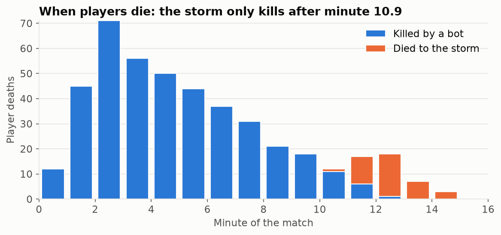
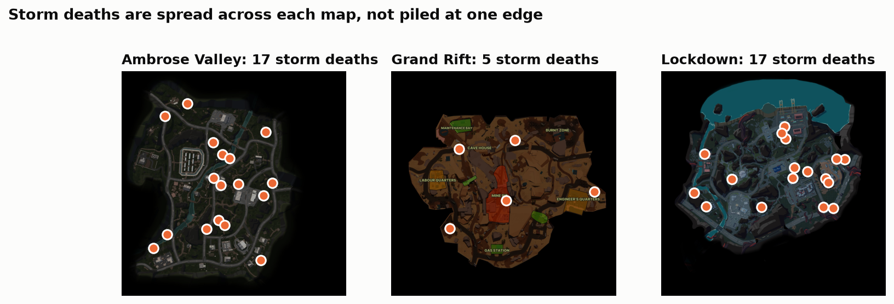

# Three things the data says about LILA BLACK

All numbers: 796 matches, Feb 10-14, 2026. Each one is reproducible with `python3 pipeline/insights.py` (charts:
`pipeline/figures.py`), and every link below opens the matching view in the tool. What to do with these, and a
fourth finding about players, are in [PRODUCT.md](PRODUCT.md).

---

## 1. The storm is a clock, and it takes the fullest bags

**What caught my eye.** Storm deaths never show up early. On the
[storm deaths heatmap](https://lila.belfiore.me/#mode=heat&map=Lockdown&layer=storm) they are scattered all
over the playable area, not piled up at one edge, as you would expect from a storm that pushes across the map.

**The evidence.**

- 0 storm deaths before minute 10.9; all 39 happen between minutes 10.9 and 14.8, each one the last event of its match.
- Of the 134 matches that last 11 minutes or more, 38 end in a storm death (28%).
- Storm victims had looted a median of **18 items**, close to survivors (21.5) and more than twice
  players killed by bots (8). They lose the longest runs: median 12.3 minutes of play.
- Their death spots span 14% to 90% of the map's width: they were caught in the middle of the map, not at its edges.

**What to do.**
- Look at extraction points from where storm victims stood at minute 10: are they reachable in time, and visible?
- Add a clear "extract now" cue around minute 10, or an extraction point closer to the mid-map areas where
  late players are found.
- Metrics: storm deaths per match (target: down), extraction rate of 10+ minute runs (up), retention after a
  storm death (a 12-minute run lost with a full bag is the worst feeling the game can give).

**Why a level designer should care.** Extraction placement and routes are pure level design. A storm death is
rarely the player's fault if they did not know where to go; it is a map that did not tell them.

---

## 2. In this data, LILA BLACK is a PvE game: bots make every fight

**What caught my eye.** Watching replays, the only other dots on the map are bots, and every red marker is a bot kill.

**The evidence.**

- 794 of 796 matches carry exactly one human journey; 2 carry two.
- Humans killed **2,240 bots and 3 humans**: 99.9% of kills are bots.
- Of 445 human deaths, **90.6% are to bots**, 8.8% to the storm, 0.7% (3) to other humans.

This is either the export (one human per match was kept) or real matchmaking (low concurrency, rooms filled
with bots). Worth asking the data team first: the two readings lead to very different actions.

**What to do.**
- If it is real: bot spawns and patrols are the level design tool that decides where fights happen. Place
  them on purpose, around the routes and POIs you want contested.
- Check whether PvP-oriented spaces (chokepoints, sight lines across open ground) still earn their place in
  a mostly PvE match, or need bots to give them a reason.
- Metrics: kills per match and time to first fight per area; once more humans share a match, PvP encounter
  rate per match.

**Why a level designer should care.** In an extraction shooter, the map is designed for players to run into
each other. If they do not, the combat layout is really a bot layout, and should be designed as one.

---

## 3. Ambrose Valley: the center is a death trap that pays no better than the south

**What caught my eye.** On Ambrose Valley (71% of all matches), the
[kills heatmap](https://lila.belfiore.me/#mode=heat&map=AmbroseValley&layer=kills) is one bright blob in the
middle, while the [loot heatmap](https://lila.belfiore.me/#mode=heat&map=AmbroseValley&layer=loot) is spread
over many POIs, with strong spots in the south.

**The evidence** (map cut in 3 x 3 regions):

| Region | Share of time spent | Share of loot | Share of deaths | Deaths per unit of time |
|---|---|---|---|---|
| Center | 35.4% | 37.4% | 53.5% | 1.5x the map average |
| South-center | 18.6% | 23.0% | 6.6% | 0.35x |
| West-center | 17.9% | 16.2% | 24.4% | 1.4x |

The south-center gives *more* loot per minute spent than the center (1.24 vs 1.06 of its share of time) at a
quarter of the death rate. Across the whole map, the busiest 10% of visited cells hold 49% of the time spent
and 77% of the loot.

**What to do.**
- Make risk pay: raise the value (not the count) of loot in the center, or add a reason to fight there (an
  objective, a high-tier container), so dying there is a bet, not a tax.
- Or tone down the bot pressure in the center (insight 2: bots cause 91% of deaths) and add some to the
  south, where loot is nearly free.
- Metrics: deaths per minute and loot per minute by region (the goal is that riskier areas pay more),
  survival rate on Ambrose Valley (55.7% die now), and spread of time spent across POIs.

**Why a level designer should care.** Risk and reward by area is the core loop of an extraction map. Right
now the safest route to a full bag is also the most rewarding one, so experienced players will find it, and
the center becomes a trap for new ones.

---

*Caveats: one human per match, 5 days, Feb 14 partial; "survived" means no death event (extraction is not
logged), and time spent is position samples (every ~5 s), so it measures time, not distance.*
