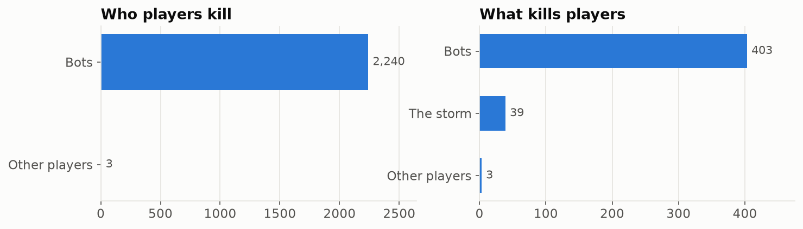
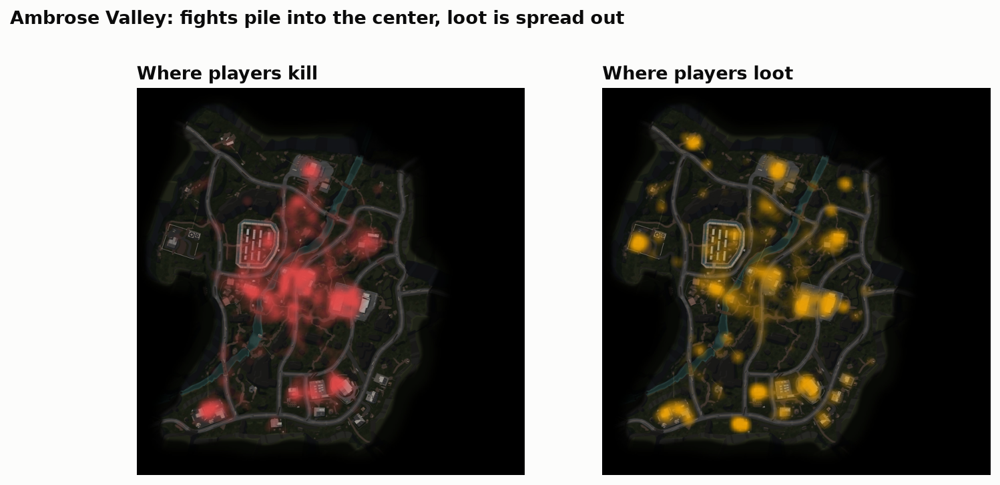
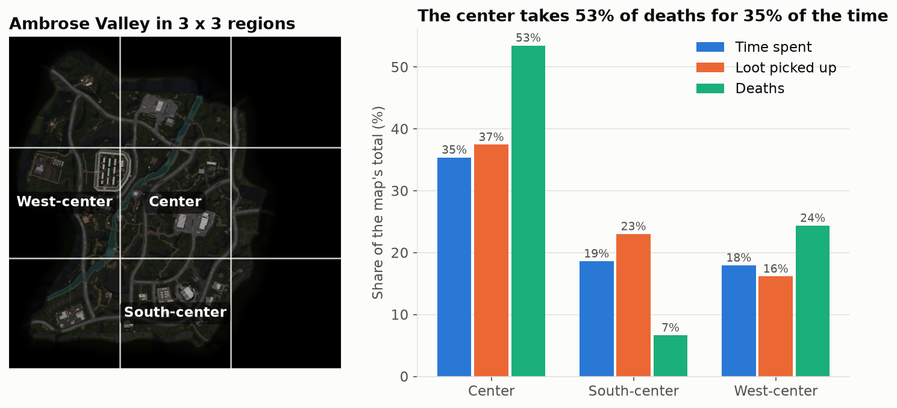

# Three things I learned about LILA BLACK with the tool

**TL;DR:** the storm only kills after minute 10.9 and takes the fullest bags; in this data the game is played
against bots, not players; and Ambrose Valley's center holds half the deaths for no better loot than the south.

Data: 796 matches, 3 maps, Feb 10-14 2026. Every number comes from `python3 pipeline/insights.py`, every chart
from `pipeline/figures.py`, and every link opens the same view in the tool. A fourth finding, about players who
never come back, and the full proposals table are in [PRODUCT.md](PRODUCT.md).

---

## 1. The storm is a clock, and it takes the fullest bags

**What caught my eye.** While replaying long matches, storm deaths never showed up early, and they were not at
the edge of the map, where I expected a closing storm to catch people. They are in the middle.
[See them on Lockdown](https://lila.belfiore.me/#mode=replay&map=Lockdown&match=all&end=storm) (every run that
ended in the storm).

**The evidence.**

- 0 storm deaths before minute 10.9. All 39 happen between minutes 10.9 and 14.8, each one the last event of its match.
- 28% of the matches that last 11 minutes or more end in a storm death (38 of 134).
- Storm victims had looted 18 items (median), almost as much as survivors (21.5) and more than twice as much as
  players killed by bots (8). They also lose the longest runs: 12.3 minutes of play.
- Their death spots go from 14% to 90% of the map's width: caught in the middle, not at the edges.

**What I would do.**
- From where the storm victims stood at minute 10, check that an extraction point is reachable in time, and visible.
- Add a clear "extract now" cue around minute 10, or an extraction point closer to the mid-map areas where late
  players are.
- Metrics: storm deaths per match (down), extraction rate of runs longer than 10 minutes (up), and whether players
  come back after a storm death. Losing 12 minutes and a full bag is the worst feeling this game can give.

**Why a level designer should care.** Where the extraction points are, and how you reach them, is pure level
design. A player who dies to the storm with a full bag usually did not know where to go: that is the map not
telling them.

---

## 2. In this data, LILA BLACK is a PvE game: bots make every fight

**What caught my eye.** In the replays, the only other moving dots are bots, and nearly every kill icon is a bot
kill. [See where bots kill players on Ambrose Valley](https://lila.belfiore.me/#mode=replay&map=AmbroseValley&match=all&layer=deaths&deaths=bots&under=1&replay=0).

**The evidence.**

- 794 of 796 matches have exactly one human; 2 have two.
- Players killed **2,240 bots and 3 players**: 99.9% of kills are bots.
- Of 445 player deaths, **90.6% are to bots**, 8.8% to the storm and 0.7% (3) to another player.

This is either the export (only one human per match kept) or the real matchmaking (few players online, rooms
filled with bots). I would ask the data team first, because the two answers lead to very different actions.

**What I would do.**
- If it is real, bot spawns and patrols are the tool that decides where fights happen. Place them on purpose,
  around the routes and POIs you want contested.
- Check that PvP spaces (chokepoints, long sight lines over open ground) still have a reason to exist in a
  mostly PvE match, or give them one with bots.
- Metrics: kills per match and time to the first fight, per area; once matches hold more humans, player vs
  player fights per match.

**Why a level designer should care.** An extraction map is built for players to run into each other. If they
don't, the combat layout is really a bot layout, and should be designed as one.

---

## 3. Ambrose Valley: the center is a death trap that pays no better than the south

**What caught my eye.** On Ambrose Valley (71% of all matches), the
[bot kills heatmap](https://lila.belfiore.me/#mode=replay&map=AmbroseValley&match=all&layer=kills&kills=bots&under=1&replay=0)
is one bright blob in the middle, while the
[loot heatmap](https://lila.belfiore.me/#mode=replay&map=AmbroseValley&match=all&layer=loot&under=1&replay=0)
is spread over many POIs, with strong spots in the south.

**The evidence** (the map cut in 3 x 3 regions):

| Region | Time spent | Loot | Deaths | Deaths per minute spent |
|---|---|---|---|---|
| Center | 35.4% | 37.4% | 53.5% | 1.5x the map average |
| South-center | 18.6% | 23.0% | 6.6% | 0.35x |
| West-center | 17.9% | 16.2% | 24.4% | 1.4x |

The south-center gives more loot per minute than the center (1.24 against 1.06 of its share of time), for a
quarter of the death rate. Over the whole map, the busiest 10% of the visited ground holds 49% of the time
spent and 77% of the loot.

**What I would do.**
- Make risk pay: raise the value (not the number) of the items in the center, or add a reason to fight there
  (an objective, a high-tier container), so that dying there is a bet, not a tax.
- Or lower the bot pressure in the center (bots cause 91% of deaths, see insight 2) and add some in the south,
  where loot is nearly free.
- Metrics: deaths per minute and loot per minute by region (riskier areas should pay more), survival rate on
  Ambrose Valley (55.7% of runs die today), and how evenly time is spread over the POIs.

**Why a level designer should care.** Risk against reward, area by area, is the core loop of an extraction map.
Today the safest route to a full bag is also the best one: experienced players will find it, and the center
becomes a trap for new players.

---

*Limits: one human per match, 5 days, Feb 14 partial. "Survived" means no death was logged (the game does not
log extraction). Time spent is counted from position samples (about one every 5 s), so it measures time, not
distance. What the game should log next to answer more is in the tool's Overview and in PRODUCT.md.*
