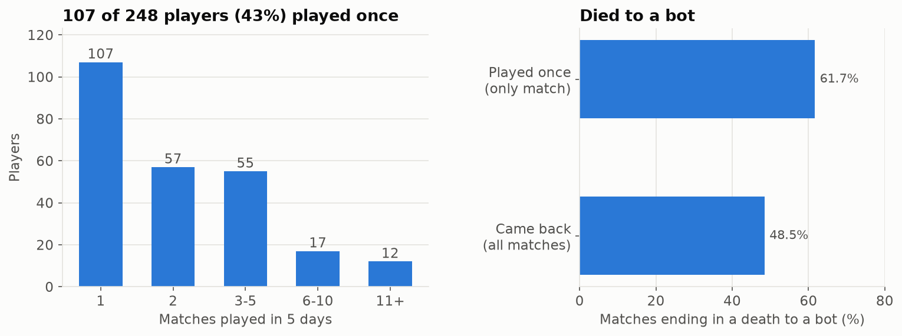
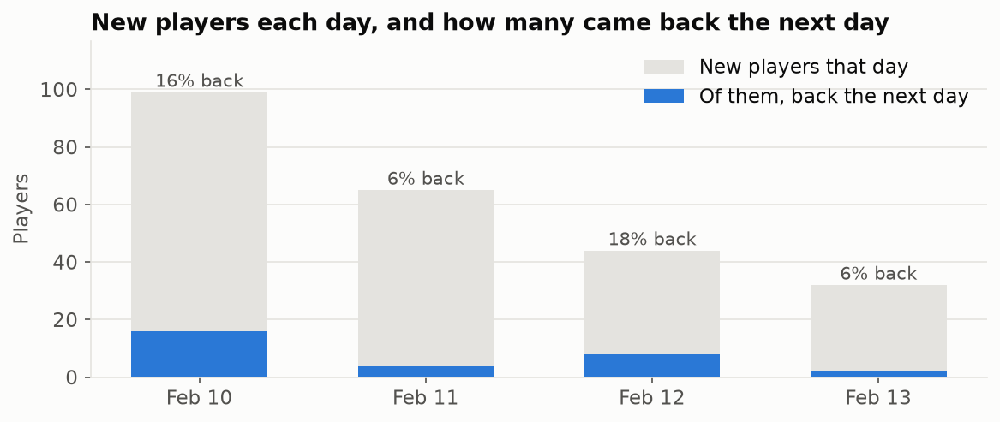

# What I learned about LILA BLACK, and how I built the tool to see it

**TL;DR:** the storm only kills after minute 10.9 and takes the fullest bags; bots cause 91% of player deaths, and
43% of players played a single match, most of them dying to a bot in it; Ambrose Valley's center holds half the
deaths for no better loot than the south.

## The tool

I chose to make this a tool that is easy to use in the browser, hosted on my own website for now
(https://lila.belfiore.me), rather than an artifact: it lets me manage the code and the data better. I built it to
be usable straight away, in the simplest way possible. For that, people usually forget the basics, the things that
make a tool robust and usable:

- Runs in the browser, and installs as a Chromium web app (a real app later, if needed).
- Works offline as much as possible after the first load.
- Takes new data with a simple drag and drop (the Data tab).
- Undo and redo for data, selection and settings: very important, and often forgotten.
- Optimistic UI while things load in the background.
- Responsive UI, on a phone as on a PC.

| 10 matches together, then in 3D | Hover, zoom, open a player |
|---|---|
|  |  |

## Main data

- 796 matches
- 248 players (and 92 bots recorded)
- 89,016 events
- 3 maps
- 5 days (Feb 10-14, 2026)

Every number below comes from `python3 pipeline/insights.py`, every chart from `pipeline/figures.py`, and every
link opens the same view in the tool. The full proposals table is in [PRODUCT.md](PRODUCT.md).

---

## 1. The storm is a clock, and it takes the fullest bags

**What caught my eye.** While replaying long matches, storm deaths never showed up early, and they were not at
the edge of the map, where I expected a closing storm to catch people. They are in the middle.
[See them on Lockdown](https://lila.belfiore.me/#mode=replay&map=Lockdown&match=all&end=storm) (every run that
ended in the storm).

**The evidence.**

- 0 storm deaths before minute 10.9. All 39 happen between minutes 10.9 and 14.8, each one the last event of its match.
- 28% of the matches that last 11 minutes or more end in a storm death (38 of 134).
- Storm victims had looted 18 items (median), almost as much as survivors (21.5) and more than twice as much as
  players killed by bots (8). They also lose the longest runs: 12.3 minutes of play.
- Their death spots go from 14% to 90% of the map's width: caught in the middle, not at the edges.

**What I would do.**
- From where the storm victims stood at minute 10, check that an extraction point is reachable in time, and visible.
- Add a clear "extract now" cue around minute 10, or an extraction point closer to the mid-map areas where late
  players are.
- Metrics: storm deaths per match (down), extraction rate of runs longer than 10 minutes (up), and whether players
  come back after a storm death. Losing 12 minutes and a full bag is the worst feeling this game can give.

**Why a level designer should care.** Where the extraction points are, and how you reach them, is pure level
design. A player who dies to the storm with a full bag usually did not know where to go: that is the map not
telling them.

---

## 2. Bots make every fight, and new players leave after dying to one

**What caught my eye.** In the replays, the only other moving dots are bots, and nearly every kill icon is a bot
kill. [See where bots kill players on Ambrose Valley](https://lila.belfiore.me/#mode=replay&map=AmbroseValley&match=all&layer=deaths&deaths=bots&under=1&replay=0).

**The evidence.**

- 794 of 796 matches have exactly one human; 2 have two.
- Players killed **2,240 bots and 3 players**: 99.9% of kills are bots.
- Of 445 player deaths, **90.6% are to bots**, 8.8% to the storm and 0.7% (3) to another player.

It may also cost players (a correlation to test, not proof). **43% of players (107 of 248) played a single match**, and that only match ended in a
death to a bot 61.7% of the time; for players who came back, 48.5% of their matches did. Next-day return is 6% to
18% depending on the day.

One human per match is either the export (only one kept) or the real matchmaking (few players online, rooms
filled with bots). I would ask the data team first, because the two answers lead to very different actions.

**What I would do.**
- First matches: for a player's first 3 matches, fewer or softer bots near the spawn and the first POIs, and an
  extraction point shown from minute 0. A/B test it on new players.
- If one human per match is real, bot spawns and patrols are the tool that decides where fights happen. Place them on purpose,
  around the routes and POIs you want contested.
- Check that PvP spaces (chokepoints, long sight lines over open ground) still have a reason to exist in a
  mostly PvE match, or give them one with bots.
- Metrics: first-match survival, matches per player and next-day return (for new players); kills per match and
  time to the first fight, per area; once matches hold more humans, player vs player fights per match.

**Why a level designer should care.** An extraction map is built for players to run into each other. If they
don't, the combat layout is really a bot layout, and should be designed as one. And where the first bots stand is
level design too: it decides whether a new player's first match is their last.

---

## 3. Ambrose Valley: the center is a death trap that pays no better than the south

**What caught my eye.** On Ambrose Valley (71% of all matches), the
[bot kills heatmap](https://lila.belfiore.me/#mode=replay&map=AmbroseValley&match=all&layer=kills&kills=bots&under=1&replay=0)
is one bright blob in the middle, while the
[loot heatmap](https://lila.belfiore.me/#mode=replay&map=AmbroseValley&match=all&layer=loot&under=1&replay=0)
is spread over many POIs, with strong spots in the south.

| Traffic, loot, then kills and deaths | Kill zones, then the same heat in 3D |
|---|---|
|  |  |

**The evidence** (the map cut in 3 x 3 regions):

| Region | Time spent | Loot | Deaths | Deaths per minute spent |
|---|---|---|---|---|
| Center | 35.4% | 37.4% | 53.5% | 1.5x the map average |
| South-center | 18.6% | 23.0% | 6.6% | 0.35x |
| West-center | 17.9% | 16.2% | 24.4% | 1.4x |

The south-center gives more loot per minute than the center (1.24 against 1.06 of its share of time), for a
quarter of the death rate. Over the whole map, the busiest 10% of the visited ground holds 49% of the time
spent and 77% of the loot.

**What I would do.**
- Make risk pay: raise the value (not the number) of the items in the center, or add a reason to fight there
  (an objective, a high-tier container), so that dying there is a bet, not a tax.
- Or lower the bot pressure in the center (bots cause 91% of deaths, see insight 2) and add some in the south,
  where loot is nearly free.
- Metrics: deaths per minute and loot per minute by region (riskier areas should pay more), survival rate on
  Ambrose Valley (55.7% of runs die today), and how evenly time is spread over the POIs.

**Why a level designer should care.** Risk against reward, area by area, is the core loop of an extraction map.
Today the safest route to a full bag is also the best one: experienced players will find it, and the center
becomes a trap for new players.

---

---

## What to log next

For a more useful tool, we would need a few more data points. They could easily be added to the game code with a
few prompts in Claude, and would help more than the current data. Today a kill holds only the killer's position
and the time: **no victim, no aim**.

- **Kills and deaths**: the other side's id and position, weapon, distance, line of sight → a line of fire for every fight.
- **Facing** on position samples, 1-2 s sampling in combat → sightlines.
- **Storm zone**: its edge or radius every few seconds. **Needed next time**: today only its victims are logged, so
  the moving storm cannot be shown (the timeline marks when it starts killing, minute 10.9).
- **Extraction** events → a real extraction rate (today "survived" = no death logged).
- **Match start** (humans and bots in the match, spawn point) and **wall-clock time** → matchmaking and
  first-match analysis.
- **Level geometry** (collision mesh or navmesh export) → real line of sight with walls and cover, and whether each
  power position can be reached from several routes.
- **Loot value**, every bot logged, test accounts flagged.

## Data we had to get right

Notes from my Claude agent; the full list, with what I decided for each, is in [ARCHITECTURE.md](ARCHITECTURE.md).

- **Coordinates.** `u = (x - originX) / scale`, `v = (z - originZ) / scale`, image y flipped; `y` is height.
  Checked three ways: the README's worked example (pixel 78, 890) as a test, all 89,104 rows inside their map,
  paths on roads. The minimaps are 4320, 2160 and 9000 px, not 1024: mapping in UV makes it harmless.
- **Timestamps are seconds, typed as milliseconds.** Read as ms, matches last under 1 s; as seconds, 13 s to 15 min.
- **Bots by movement, not by id.** 17 files with numeric (bot-style) ids move and loot like humans (mostly user
  1429): classified as humans.
- **Same event, two meanings.** A human's `BotKill` is "I killed a bot", a bot's is "this bot killed someone":
  stored by meaning.
- **One journey exported twice** (a match across midnight, Feb 10 and 11): read once.
- **Killer → victim pairs**: 36 where both events are recorded, plus 6 inferred (drawn lighter). 95% of fights
  happen in matches with no bot recorded: there, the data has no victim at all.
- **Player vs player is 3 events**, each a Kill and a Killed of the same player at the same second and spot, at
  the end of the match: a trade or a self-kill, the other player's file is missing.
- **The terrain is an estimate**, from where players and bots walked; walls and buildings are not in the data.

*Limits: one human per match, 5 days, Feb 14 partial. "Survived" means no death was logged. Time spent is counted
from position samples (about one every 5 s), so it measures time, not distance. "First match" means a player's
only match in the data: there is no wall clock to order matches within a day.*
