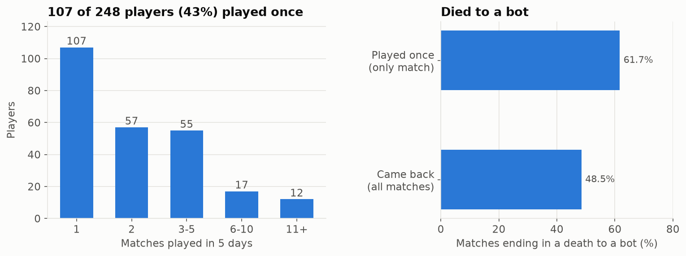
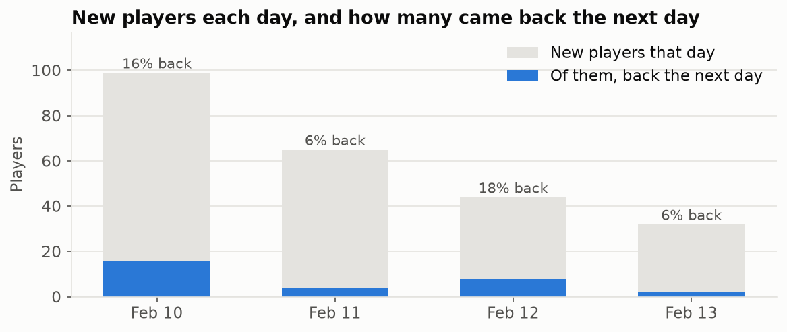
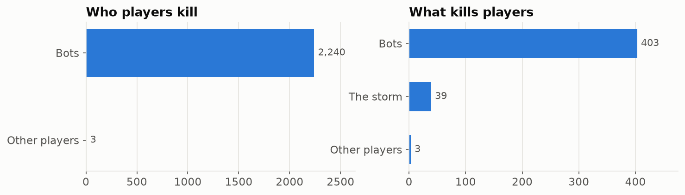
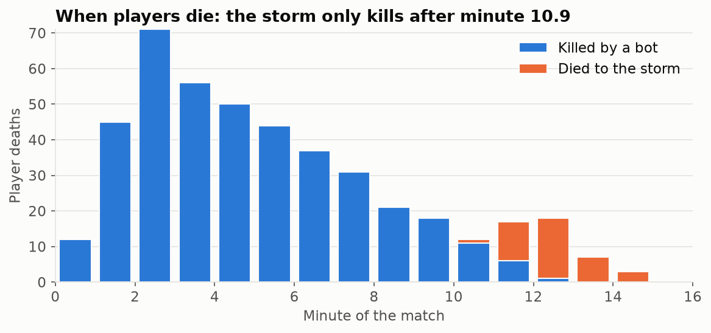
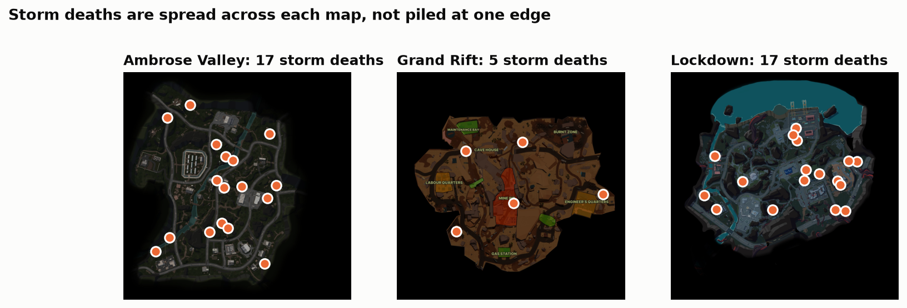
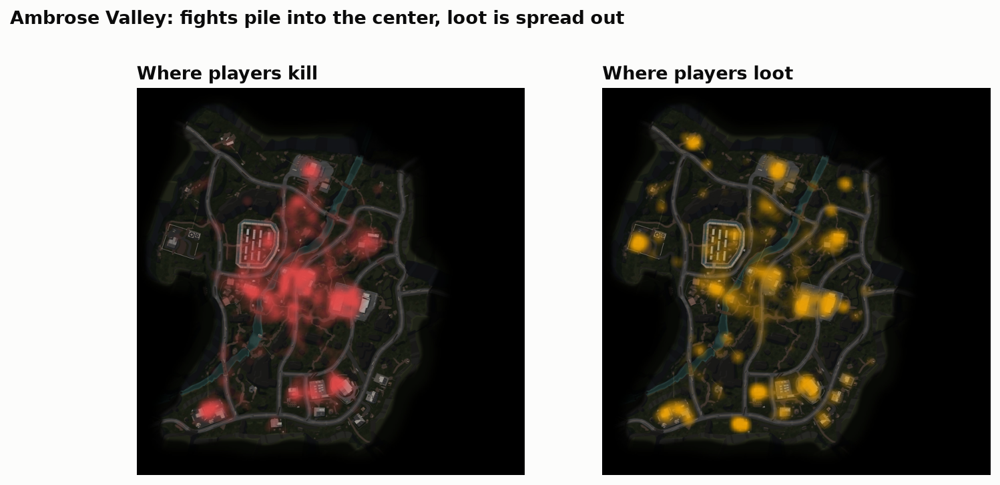
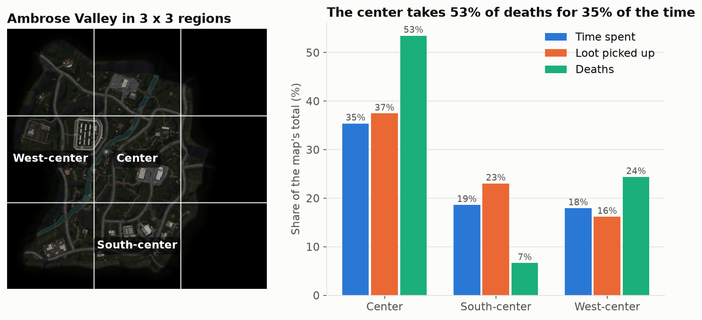

# Why this tool, and what to do with it

> "Right now, they have raw telemetry data but no easy way to see what's happening visually — where players
> move, where fights break out, where people die to the storm, and which areas of the map get ignored."
> (LILA's brief)

A visualizer is only worth building if it changes a decision. This page covers who decides what with it, what
the data already says (each claim with a chart, its numbers and a link to the same view in the tool), what we
propose, what we assumed, and what the game should log next.

All numbers: `python3 pipeline/insights.py`. All charts: `.venv/bin/python pipeline/figures.py`. Both read only
the processed files in `public/data/`.

## Why the team needs this tool

It serves the loop from the job post: **idea → change → telemetry → see it on the map → keep or revert**, in
days rather than weeks.

| Who | Decision it supports | Where in the tool |
|---|---|---|
| Level designers | Which POIs, routes and corners are used, ignored or deadly; whether players reach extraction before the storm; whether a layout change actually moved players | Heatmaps (traffic, loot, kills, deaths, storm) per day; compare the days before and after a change |
| Game designers | Whether bots are too strong or badly placed: bots cause 91% of player deaths | "Position when killed: bots" heatmap; replays with bot paths and killer → victim lines |
| Product | Why new players stop | Match replay, Players "Played only once", Select all |
| Everyone | A shared view instead of a screenshot in a meeting | Every view is a link (the links below open exactly the view shown) |

## Decision support: what the data says

### 1. New players stop after one match, and most of them died to a bot

| Matches played in 5 days | 1 | 2 | 3-5 | 6-10 | 11+ |
|---|---|---|---|---|---|
| Players | 107 | 57 | 55 | 17 | 12 |

- **43% of players (107 of 248) played a single match.**
- Their only match ended in a death to a bot **61.7%** of the time; for players who came back, 48.5% of
  their matches did.

| First day | Feb 10 | Feb 11 | Feb 12 | Feb 13 |
|---|---|---|---|---|
| New players | 99 | 65 | 44 | 32 |
| Back the next day | 16 (16%) | 4 (6%) | 8 (18%) | 2 (6%) |

**See it**: [the 84 Ambrose Valley matches of players who never came back, all at once](https://lila.belfiore.me/#mode=replay&map=AmbroseValley&match=all&players=once)
(where they went, where they died).

### 2. Bots make every fight

| | Bots | The storm | Other players |
|---|---|---|---|
| Killed by players | 2,240 | | 3 |
| Killers of players | 403 (90.6%) | 39 (8.8%) | 3 (0.7%) |

794 of 796 matches carry a single human. For a new player, the game *is* the bots.
**See it**: [where players get killed by bots, Ambrose Valley](https://lila.belfiore.me/#mode=heat&map=AmbroseValley&layer=deaths&deaths=bots).

### 3. The storm is a clock, and it takes the fullest bags

| Minute | 0-9 | 10 | 11 | 12 | 13 | 14 |
|---|---|---|---|---|---|---|
| Killed by a bot | 385 | 11 | 6 | 1 | 0 | 0 |
| Died to the storm | 0 | 1 | 11 | 17 | 7 | 3 |

28% of the matches that last 11 minutes or more end in a storm death. Storm victims had looted a median 18
items (players killed by bots: 8), and died in the middle of the map, not at an edge.
**See it**: [storm deaths over traffic, Lockdown](https://lila.belfiore.me/#mode=heat&map=Lockdown&layer=traffic,storm).

### 4. Ambrose Valley's center is a death trap that pays no better than the south

| Region | Time spent | Loot | Deaths | Deaths per unit of time |
|---|---|---|---|---|
| Center | 35.4% | 37.4% | 53.5% | 1.5x the map average |
| South-center | 18.6% | 23.0% | 6.6% | 0.35x |
| West-center | 17.9% | 16.2% | 24.4% | 1.4x |

**See it**: [kills over loot, Ambrose Valley](https://lila.belfiore.me/#mode=heat&map=AmbroseValley&layer=loot,kills).

## Proposals, most leverage first

| # | Proposal | Based on | Test | Metrics that should move |
|---|---|---|---|---|
| 1 | **First-match bots (FTUE)**: for a player's first 3 matches, fewer or softer bots near spawn and the first POIs; an extraction point shown from minute 0 | Finding 1, 2 | A/B on new players | First-match survival, matches per player, next-day return |
| 2 | **Extraction before the storm**: an "extract now" cue at minute 10; check that extraction points are reachable from where storm victims stood | Finding 3 | Before / after, same map | Storm deaths per match, extraction rate of 10+ minute runs |
| 3 | **Make risk pay on Ambrose Valley**: raise loot value in the center, or move bot pressure to the south, where loot is nearly free | Finding 4 | Before / after the change | Loot and deaths per minute by region: riskier areas should pay more |
| 4 | **Decide what matchmaking is for**: more humans per match (fewer rooms, longer queues) so PvP spaces live, or design the maps for PvE | Finding 2 | Product decision first | PvP encounters per match, queue time |

In the tool today, each proposal has a view to check it with (the links above). With the logging asks below,
it gets a "first 3 matches" filter and a before / after comparison.

## Assumptions and limits

- **A small, partial sample**: 5 days, 248 players, Feb 14 partial, a game LILA's site now lists as paused.
  The findings are correlations to test, not proof.
- **One human per match** (794 of 796): either the export or real matchmaking. Worth asking the data team
  first, since the two readings lead to different actions.
- **"Survived" means no death was logged**: there is no extraction event.
- **No order within a day**: there is no wall clock, so "first match" means "a player's only match", and
  return is counted by day, not by session.
- **Time spent is position samples** (every ~5 s): it measures time, not distance.
- **Killer → victim lines exist for 42 fights only**: 36 recorded, 6 inferred from a nearby bot path (see below).

## What to log next (so the tool can answer more)

Today a kill row holds only the killer's own position and the time: **no victim id, no victim position, no aim
or facing**. A victim is known only when its own file exists (bot files: 52 of 796 matches), so 36 of ~2,650
fights can be drawn as killer → victim lines. Asks, smallest change first:

| Event | Add | Unlocks |
|---|---|---|
| `Kill`, `BotKill`, `Killed`, `BotKilled` | other side's id and position, weapon, distance, line of sight | Lines of fire for every fight, sightline heatmaps, weapon range by area |
| Every position sample | facing (yaw), and 1-2 s sampling in combat instead of ~5 s | Where players look, what they see from each corner |
| New: `Extracted` | extraction point id, time, loot value carried | Real extraction rate (today "survived" = no death logged) |
| **New: storm zone (needed next time)** | storm edge position or radius per match, every 5-10 s | Draw the storm moving on the replay (asked for; impossible today: only its victims are logged); who it catches and why |
| New: `MatchStart` | humans and bots in the match, spawn point, mode, party size | Matchmaking analysis; spawn heatmaps; first-match filter |
| Every row | wall-clock UTC time; `ts` stored in its real unit (seconds today, typed as ms) | Order a player's matches, sessions, retention by match number |
| `Loot` | item id, rarity or value, container id | Loot value heatmaps: where the rich loot is, not just the count |
| Bots | every bot logged in every match, with an archetype or difficulty tier | Bot placement and tuning per area |
| Level geometry | the collision mesh or navmesh, exported once per map version | Real line of sight (walls, cover), sniper spots, and whether each power position can be reached from several routes |
| Ids | test accounts flagged (user 1429 plays like a human with a bot-style id) | Clean data without guesswork |

The tool is ready for each of these: the pipeline maps any (x, z) to the minimap, and a new event is a new
heatmap layer or replay marker.
